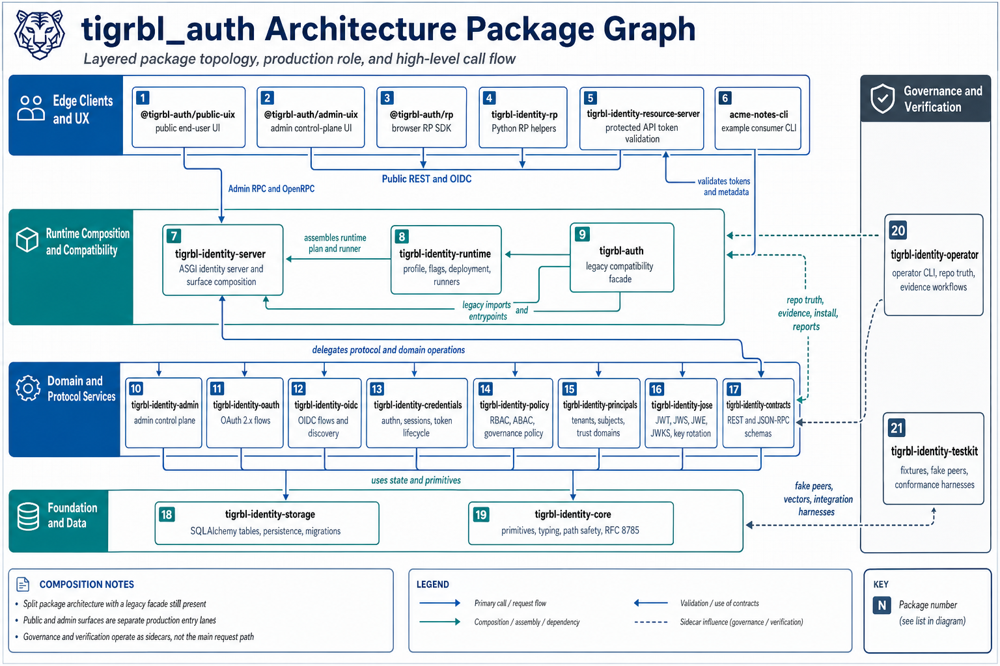

# TBA · Tigrbl Auth

<!-- BEGIN TBA README HEADER -->
<p align="center">
<a href="https://github.com/tigrbl/tigrbl_auth#readme"></a>
</p>
<p align="center">
<a href="https://github.com/tigrbl/tigrbl_auth/blob/master/pyproject.toml"></a>
<a href="https://github.com/tigrbl/tigrbl_auth/blob/master/pyproject.toml"></a>
<a href="https://github.com/tigrbl/tigrbl_auth/blob/master/pyproject.toml"></a>
<a href="https://pypi.org/project/tba-auth/"></a>
</p>
<p align="center">
<a href="https://pepy.tech/project/tba-auth"></a>
<a href="https://github.com/tigrbl/tigrbl_auth/actions/workflows/master.yml"></a>
<a href="https://github.com/tigrbl/tigrbl_auth/blob/master/.ssot/registry.json"></a>
<a href="https://github.com/tigrbl/tigrbl_auth/blob/master/CERTIFICATION_STATUS.md"></a>
</p>
<!-- END TBA README HEADER -->

TBA is the Tigrbl authentication and authorization suite. Use it to serve OAuth and OpenID Connect, integrate identity and policy checks into a Tigrbl application, or install a focused protocol, provider, storage, or client package.

## Quick start

From a checkout, use [uv](https://docs.astral.sh/uv/) to inspect the baseline OAuth and OpenID Connect discovery snapshots. This runs the published TBA distribution in an isolated Python 3.12 environment and reads the snapshots in this repository.

```bash
uv run --isolated --no-project --python 3.12 --with tba-auth==0.4.0.dev2 tba-auth discovery --format json show --repo-root .
```

Expect a JSON object with `"command": "discovery.show"` and a `documents` object containing `openid-configuration.json`, `oauth-authorization-server.json`, and `jwks.json`. The baseline snapshots use an example issuer and an empty key set.

## Choose an integration

| If you want to… | Start here |
| --- | --- |
| Run a public OAuth/OIDC API | [Public backend app](pkgs/90-backend-apps/tba-app-backend-public/README.md) and the [local Compose configuration](docker/docker-compose.public-app.yml) |
| Embed identity in a Tigrbl app | [Tigrbl plugin](pkgs/60-runtime/tba-plugin-tigrbl/README.md) |
| Maintain an app using `tba_auth` imports | [Compatibility facade](pkgs/70-facade/tba-auth/README.md) |
| Try a client-side login flow | [OAuth device authorization CLI](pkgs/110-examples/tba-example-oauth-device-authorization-cli/README.md) |
| Operate a deployment | [Identity CLI](pkgs/60-runtime/tba-cli-identity/README.md) and [CLI command reference](docs/reference/CLI_SURFACE.md) |

## Architecture

Applications compose routers and runtime services over protocol packages, capabilities, providers, and storage. The runtime supplies the persistence and configuration those components need. Downstream products can use the upstream tables and bootstrap operations when provisioning realms, tenants, principals, roles, clients, sessions, and keys.



## Package catalog

Start with a representative package below or browse the [full package tree](pkgs/). Each active package has its own README. Active Python distributions and imports use `tba-*` and `tba_*`. UI packages use `@tba/*`. See the [namespace migration guide](docs/packaging/tba-namespace-migration.md) for legacy names and environment variables.

| Layer | Start here |
| --- | --- |
| 00 · Primitives | [tba-primitives-identity](pkgs/00-primitives/tba-primitives-identity/README.md) |
| 01 · Storage | [tba-storage-core](pkgs/01-storage/tba-storage-core/README.md) |
| 02 · Contracts | [tba-contracts-identity-document](pkgs/02-contracts/tba-contracts-identity-document/README.md) |
| 05 · Base classes | [tba-bases-authenticator](pkgs/05-bases/tba-bases-authenticator/README.md) |
| 10 · Concrete implementations | [tba-concrete-amr-evaluator-basic](pkgs/10-concrete/tba-concrete-amr-evaluator-basic/README.md) |
| 20 · Providers | [tba-provider-authenticator-password-local](pkgs/20-providers/tba-provider-authenticator-password-local/README.md) |
| 30 · Durable operations | [tba-durability-replay-protection](pkgs/30-storage-runtime/tba-durability-replay-protection/README.md) |
| 40 · Capabilities | [tba-capability-account-self-service](pkgs/40-capabilities/tba-capability-account-self-service/README.md) |
| 50 · Protocols | [tba-protocol-cwt](pkgs/50-protocols/tba-protocol-cwt/README.md) |
| 55 · Profiles | [tba-profile-oauth-jwt-access-token](pkgs/55-profiles/tba-profile-oauth-jwt-access-token/README.md) |
| 60 · Runtime and CLI | [tba-cli-identity](pkgs/60-runtime/tba-cli-identity/README.md) |
| 70 · Facade | [tba-auth](pkgs/70-facade/tba-auth/README.md) |
| 75 · Clients | [tba-client-policy-decision](pkgs/75-clients/tba-client-policy-decision/README.md) |
| 80 · Routers | [tba-router-oauth-protected-resource-metadata](pkgs/80-routers/tba-router-oauth-protected-resource-metadata/README.md) |
| 85 · Middleware | [tba-middleware-policy-enforcement-asgi](pkgs/85-middleware/tba-middleware-policy-enforcement-asgi/README.md) |
| 90 · Backend apps | [tba-app-backend-public](pkgs/90-backend-apps/tba-app-backend-public/README.md) |
| 100 · UI primitives | [@tba/ui-primitives](pkgs/100-uix-core/tba-ui-primitives/README.md) |
| 104 · Authenticator UIs | [@tba/ui-mfa-authenticator-assurance-console](pkgs/104-authenticator-uis/tba-ui-mfa-authenticator-assurance-console/README.md) |
| 105 · Product UIs | [@tba/ui-my-account](pkgs/105-ui/tba-ui-my-account/README.md) |
| 106 · UI prototypes | [@tba/ui-trust-center](pkgs/106-ui/tba-ui-trust-center/README.md) |
| 110 · Examples | [tba-example-oauth-device-authorization-cli](pkgs/110-examples/tba-example-oauth-device-authorization-cli/README.md) |
| 120 · Testkits | [tba-testkit-identity](pkgs/120-tests/tba-testkit-identity/README.md) |

## Release and certification evidence

The published version badge refers to the `tba-auth` facade on PyPI. The workspace version badge refers to this checkout. The certification reports describe the exact scope of validated claims. Final certification and strict independent claims remain open in the current checkpoint.

- [Current state](CURRENT_STATE.md) and [certification status](CERTIFICATION_STATUS.md)
- [Document authority and truth chain](docs/compliance/truth_chain.md)
- [Validated execution report](docs/compliance/validated_execution_report.md) and [final release gate](docs/compliance/final_release_gate_report.md)
- [Canonical reference docs](docs/reference/README.md) and [package release process](docs/packaging/monorepo-release.md)

## README maintenance

The shared logo lives at [docs/assets/tba-brand.png](docs/assets/tba-brand.png). Package READMEs use its canonical raw URL so the same asset can render off GitHub once it is on the default branch. To update managed headers after a manifest change, run `python scripts/render_readme_branding.py` with Python 3.11 or newer. Add `--check` to detect drift. Keep the example and package guidance outside the managed block. See the [quick start verification record](docs/packaging/readme-verification.md) for checks and known build blockers.

[Documentation](docs/README.md) · [Issues](https://github.com/tigrbl/tigrbl_auth/issues) · [Apache 2.0 license](LICENSE)
