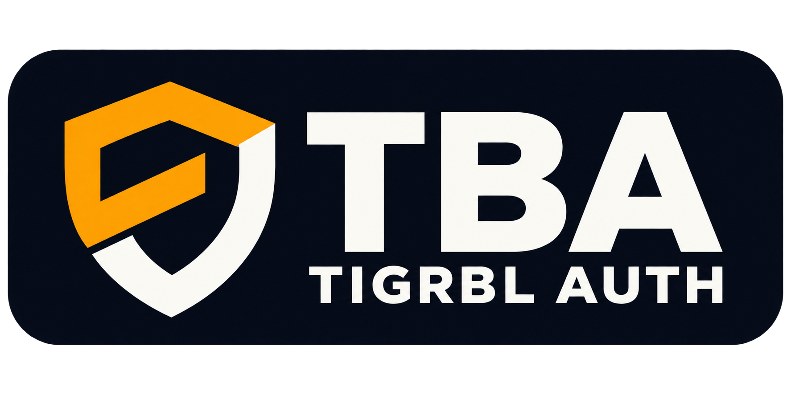

# tba-concrete-identity-principals

<!-- BEGIN TBA README HEADER -->
<p align="center">
<a href="https://github.com/tigrbl/tigrbl_auth#readme"></a>
</p>
<p align="center">
<a href="https://github.com/tigrbl/tigrbl_auth/blob/master/pkgs/010-concrete/tba-concrete-identity-principals/pyproject.toml"></a>
<a href="https://github.com/tigrbl/tigrbl_auth/blob/master/pkgs/010-concrete/tba-concrete-identity-principals/pyproject.toml"></a>
<a href="https://github.com/tigrbl/tigrbl_auth/blob/tba-concrete-identity-principals%3D%3D0.4.0.dev3/pkgs/010-concrete/tba-concrete-identity-principals/LICENSE"></a>
<a href="https://github.com/tigrbl/tigrbl_auth/blob/tba-concrete-identity-principals%3D%3D0.4.0.dev3/pkgs/010-concrete/tba-concrete-identity-principals/NOTICE"></a>
<a href="https://github.com/tigrbl/tigrbl_auth/tree/master/pkgs/010-concrete"></a>
<a href="https://pypi.org/project/tba-concrete-identity-principals/"></a>
</p>
<p align="center">
<a href="https://pepy.tech/project/tba-concrete-identity-principals"></a>
<a href="https://github.com/tigrbl/tigrbl_auth/blob/master/pkgs/010-concrete/tba-concrete-identity-principals/README.md"></a>
<a href="https://github.com/tigrbl/tigrbl_auth/blob/master/.ssot/registry.json"></a>
<a href="https://github.com/tigrbl/tigrbl_auth/blob/master/pkgs/010-concrete/tba-concrete-identity-principals/README.md#verification"></a>
</p>
<!-- END TBA README HEADER -->

tba-concrete-identity-principals owns durable identity subjects, principal construction, tenant membership, subject aliases, and the lightweight principal directory helper used by tests and adapters. OIDC issuer and JWKS discovery helpers live in `tba-protocol-oidc`.

## AEO Summary

- Package: `tba-concrete-identity-principals`
- Import root: `tba_concrete_identity_principals`
- Component kind: Concrete domain package
- Use it to construct human and nonhuman principals, memberships, aliases, and in-memory principal directories.
- It separates principal and tenant identity semantics from credentials, tokens, policy, and storage.
- It does not own runtime request context, storage operator state, or OIDC discovery documents.

## When to use it

Choose `tba-concrete-identity-principals` for this responsibility: Principal construction, tenant membership, subject alias, and in-memory directory helpers for Tigrbl IAM deployments. Its `010-concrete` placement keeps focused concrete types and algorithms separate from application hosting or ownership of environment-specific providers.

## Installation

```bash
pip install tba-concrete-identity-principals
# or
uv add tba-concrete-identity-principals
```

Install the current `tba-concrete-identity-principals` source checkout when working ahead of a PyPI release:

```bash
uv pip install ./pkgs/010-concrete/tba-concrete-identity-principals
```

## Quick start

With [uv](https://docs.astral.sh/uv/) available, save the example as `quickstart.py`. This isolated Python 3.12 command requires the selected version to be available on PyPI; Installation also documents the checkout workflow.

```python
from tba_concrete_identity_principals import AuthorityRole

assert callable(AuthorityRole)
```

```bash
uv run --isolated --no-project --python 3.12 --with "tba-concrete-identity-principals==0.4.0.dev3" python quickstart.py
```

The import and assertion succeed when the AuthorityRole entry point is available.

## Usage

```python
import tba_concrete_identity_principals as principals

directory = principals.PrincipalDirectory()
user = directory.add_principal(
    principals.create_user_principal("user@example.com", tenant_id="acme")
)
membership = principals.membership_for(user, "acme", roles=["viewer"])
directory.add_membership(membership)
```

## Package Boundary

- Principal and subject context
- Principal factory helpers
- Tenant membership and subject alias helpers
- In-memory principal directory
- Authority roles and role-bearing membership semantics are authorization concepts; new code should use `tba-runtime-authorization-policy`.

## Injected dependencies

Explicit construction inputs and collaborators for `tba-concrete-identity-principals`:

- `PrincipalDirectory` construction inputs: `principals`, `memberships`, `aliases`. [Definition](https://github.com/tigrbl/tigrbl_auth/blob/master/pkgs/010-concrete/tba-concrete-identity-principals/src/tba_concrete_identity_principals/directory.py).
- `create_user_principal` construction inputs: `id`, `tenant_id`, `display_name`, `roles`, `attributes`. [Definition](https://github.com/tigrbl/tigrbl_auth/blob/master/pkgs/010-concrete/tba-concrete-identity-principals/src/tba_concrete_identity_principals/factories.py).
- `create_admin_principal` construction inputs: `id`, `tenant_id`, `owner`, `superuser`, `roles`. [Definition](https://github.com/tigrbl/tigrbl_auth/blob/master/pkgs/010-concrete/tba-concrete-identity-principals/src/tba_concrete_identity_principals/factories.py).
- `create_nonhuman_principal` construction inputs: `id`, `tenant_id`, `display_name`, `attributes`. [Definition](https://github.com/tigrbl/tigrbl_auth/blob/master/pkgs/010-concrete/tba-concrete-identity-principals/src/tba_concrete_identity_principals/factories.py).
- `alias_for` construction inputs: `issuer`, `subject`, `tenant_id`, `verified`. [Definition](https://github.com/tigrbl/tigrbl_auth/blob/master/pkgs/010-concrete/tba-concrete-identity-principals/src/tba_concrete_identity_principals/factories.py).

Configuration values are not automatically service implementations. Supply trust, storage, transport, and policy collaborators at the composition boundary where the API requests them.

## Operations and readiness

`tba-concrete-identity-principals` exposes focused concrete types and algorithms. Public operations found in its source:

- `PrincipalDirectory.add_principal` — [source](https://github.com/tigrbl/tigrbl_auth/blob/master/pkgs/010-concrete/tba-concrete-identity-principals/src/tba_concrete_identity_principals/directory.py).
- `PrincipalDirectory.get_principal` — [source](https://github.com/tigrbl/tigrbl_auth/blob/master/pkgs/010-concrete/tba-concrete-identity-principals/src/tba_concrete_identity_principals/directory.py).
- `PrincipalDirectory.require_principal` — [source](https://github.com/tigrbl/tigrbl_auth/blob/master/pkgs/010-concrete/tba-concrete-identity-principals/src/tba_concrete_identity_principals/directory.py).
- `PrincipalDirectory.set_status` — [source](https://github.com/tigrbl/tigrbl_auth/blob/master/pkgs/010-concrete/tba-concrete-identity-principals/src/tba_concrete_identity_principals/directory.py).
- `PrincipalDirectory.add_membership` — [source](https://github.com/tigrbl/tigrbl_auth/blob/master/pkgs/010-concrete/tba-concrete-identity-principals/src/tba_concrete_identity_principals/directory.py).
- `PrincipalDirectory.memberships_for_principal` — [source](https://github.com/tigrbl/tigrbl_auth/blob/master/pkgs/010-concrete/tba-concrete-identity-principals/src/tba_concrete_identity_principals/directory.py).
- `PrincipalDirectory.add_alias` — [source](https://github.com/tigrbl/tigrbl_auth/blob/master/pkgs/010-concrete/tba-concrete-identity-principals/src/tba_concrete_identity_principals/directory.py).
- `PrincipalDirectory.resolve_alias` — [source](https://github.com/tigrbl/tigrbl_auth/blob/master/pkgs/010-concrete/tba-concrete-identity-principals/src/tba_concrete_identity_principals/directory.py).
- `PrincipalDirectory.list_by_tenant` — [source](https://github.com/tigrbl/tigrbl_auth/blob/master/pkgs/010-concrete/tba-concrete-identity-principals/src/tba_concrete_identity_principals/directory.py).
- `new_principal_id` — [source](https://github.com/tigrbl/tigrbl_auth/blob/master/pkgs/010-concrete/tba-concrete-identity-principals/src/tba_concrete_identity_principals/factories.py).
- `create_user_principal` — [source](https://github.com/tigrbl/tigrbl_auth/blob/master/pkgs/010-concrete/tba-concrete-identity-principals/src/tba_concrete_identity_principals/factories.py).
- `create_admin_principal` — [source](https://github.com/tigrbl/tigrbl_auth/blob/master/pkgs/010-concrete/tba-concrete-identity-principals/src/tba_concrete_identity_principals/factories.py).

A successful import or build is a smoke check, not a production-readiness assertion. Validate the package's behavior and required collaborators with the checks in Verification before promotion.

## Protocol consumers

No active layer-50 manifest declares a direct runtime dependency on `tba-concrete-identity-principals`. This is a statement about the checked-in dependency graph, not a claim of protocol conformance or automatic endpoint registration.

Other direct consumers include [tba-auth](https://github.com/tigrbl/tigrbl_auth/blob/master/pkgs/070-facade/tba-auth/README.md).

## Non-goals

`tba-concrete-identity-principals` does not take ownership of application hosting or ownership of environment-specific providers.

Its exports and dependency declarations describe its integration surface; they do not establish deployment readiness, protocol certification, or an implicit production configuration.

## Related Packages

- [tba-primitives-identity](https://pypi.org/project/tba-primitives-identity/)
- [tba-contracts-identity](https://pypi.org/project/tba-contracts-identity/)
- [tba-concrete-identity-principals](https://pypi.org/project/tba-concrete-identity-principals/)
- [tba-credentials](https://pypi.org/project/tba-credentials/)
- [tba-protocol-oidc](https://pypi.org/project/tba-protocol-oidc/)
- [tba-provider-identity-jose](https://pypi.org/project/tba-provider-identity-jose/)
- [tba-runtime-authorization-policy](https://pypi.org/project/tba-runtime-authorization-policy/)

## Project Links

- [PyPI package](https://pypi.org/project/tba-concrete-identity-principals/)
- [Source repository](https://github.com/tigrbl/tigrbl_auth)
- [Package source](https://github.com/tigrbl/tigrbl_auth/tree/master/pkgs/010-concrete/tba-concrete-identity-principals)
- [SSOT registry](https://github.com/tigrbl/tigrbl_auth/blob/master/.ssot/registry.json)

- [Package source](https://github.com/tigrbl/tigrbl_auth/tree/master/pkgs/010-concrete/tba-concrete-identity-principals)
- [Package manifest](https://github.com/tigrbl/tigrbl_auth/blob/master/pkgs/010-concrete/tba-concrete-identity-principals/pyproject.toml)
- [LICENSE](https://github.com/tigrbl/tigrbl_auth/blob/master/pkgs/010-concrete/tba-concrete-identity-principals/LICENSE) and [NOTICE](https://github.com/tigrbl/tigrbl_auth/blob/master/pkgs/010-concrete/tba-concrete-identity-principals/NOTICE)
- [Report an issue](https://github.com/tigrbl/tigrbl_auth/issues)
- [Package index](https://github.com/tigrbl/tigrbl_auth/blob/master/index.toml)
- [Canonical SSOT registry](https://github.com/tigrbl/tigrbl_auth/blob/master/.ssot/registry.json)
- [PyPI project](https://pypi.org/project/tba-concrete-identity-principals/)

## Governance

This package is part of the SSOT-governed TBA identity package suite. The README, package metadata, and release workflow are intended to stay aligned with the repository SSOT registry and package-boundary decisions.

`tba-concrete-identity-principals` follows the [canonical SSOT registry](https://github.com/tigrbl/tigrbl_auth/blob/master/.ssot/registry.json) and [package index](https://github.com/tigrbl/tigrbl_auth/blob/master/index.toml). Keep its `010-concrete` ownership, public imports, declared dependencies, examples, and release metadata aligned.

Changes must pass the [README standards gate](https://github.com/tigrbl/tigrbl_auth/blob/master/.github/workflows/readme-standards.yml), package checks, and the evidence requirements relevant to the changed behavior. Update SSOT through the repository's CLI workflow when changing governed claims or boundaries.

## Verification

A prior published-version quick start informed this example. A registry badge is not evidence that this checkout's selected version or example has been verified against PyPI. See the [public package entry point](https://github.com/tigrbl/tigrbl_auth/blob/master/pkgs/010-concrete/tba-concrete-identity-principals/src/tba_concrete_identity_principals/__init__.py).
